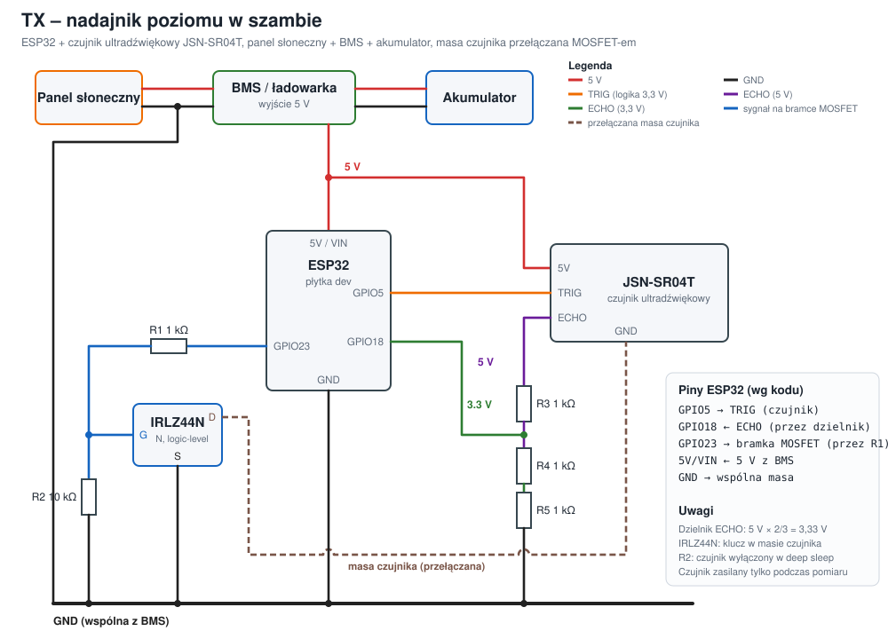
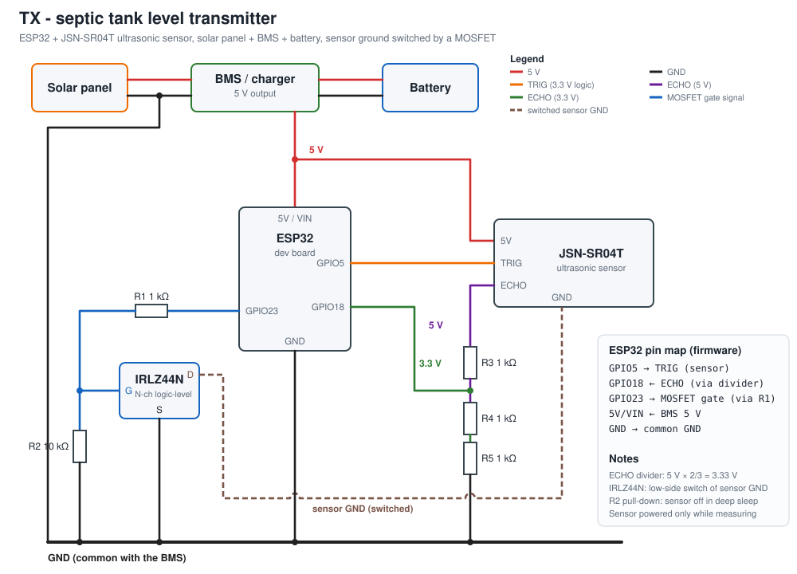

# Szambo – septic tank level monitor (ESP32 + ESP-NOW)

[🇵🇱 Polski](#-polski) · [🇬🇧 English](#-english)

---

## 🇵🇱 Polski

Bezprzewodowy miernik poziomu w zbiorniku (szambie) z prognozą „pełny za X dni”. Składa się z dwóch urządzeń na ESP32, które łączy ESP-NOW (bez routera Wi-Fi):

- **TX – nadajnik** (w zbiorniku, zasilanie z panelu słonecznego + akumulatora): co 6 godzin budzi się z deep sleep, mierzy odległość do powierzchni czujnikiem ultradźwiękowym JSN-SR04T i wysyła wynik do odbiornika. Czujnik jest zasilany tylko na czas pomiaru (MOSFET w masie czujnika).
- **RX – odbiornik** (w domu): płytka ESP32 z dotykowym ekranem 2,8" (ILI9341 + XPT2046, model **E32R28T**). Pokazuje procent wypełnienia, wolne miejsce, czas od ostatniego pomiaru oraz prognozę „pełny za X dni”. Pamięta ostatni pomiar po utracie zasilania.



### Jak to działa

- **Pomiar (TX):** 6 serii po 10 pomiarów w odstępach 20 s. Odczyty trafiają do jednej puli, a wynik to najgęstszy klaster (okno 3 cm). Pojedyncze błędne echa i zepsute serie są odrzucane. Zmiana poziomu jest walidowana względem poprzedniego wyniku (maks. tempo napełniania, wykrywanie wywozu, strefa martwa czujnika < 25 cm).
- **Komunikacja:** ESP-NOW, kanał 1. Odbiornik nie ma wpisanego adresu MAC – nadajnik znajduje go przez broadcast (discovery), więc wymiana płytki nie wymaga zmian w kodzie. Brak potwierdzenia (ACK) uruchamia ponawianie wysyłki (30/30/30/60/60/120/120 min).
- **Historia i prognoza:** TX wysyła razem z pomiarem do 14 ostatnich zatwierdzonych pomiarów z ich wiekiem. RX liczy z nich prognozę regresją liniową, więc po restarcie RX lub wymianie płytki prognoza jest od razu gotowa. Do czasu uzbierania ok. 36 h danych pokazuje wartość orientacyjną (`~N dni`, pomarańczowa, zakładane tempo 6 cm/dobę), potem prognozę z regresji (zielona).
- **Wywóz:** po opróżnieniu zbiornika przytrzymaj 3 s przycisk **RESET** na ekranie RX (i zresetuj zasilanie TX) – historia jest czyszczona i prognoza liczy się od nowa.
- **Dioda statusu** na ekranie RX: zielona < 25 h od ostatniego pomiaru, pomarańczowa 25–50 h, czerwona migająca > 50 h.
- **Logi diagnostyczne:** TX zapisuje szczegółowy log 28 ostatnich cykli i przesyła go do RX. Odczyt na komputerze: `RX/tools/txlog_pobierz.py` (patrz `RX/KOMENDY_LOGI_TX.txt`).

### Piny ESP32 (wg kodu)

**TX – nadajnik** (`TX/src/config.h`)

| Pin ESP32 | Funkcja | Podłączone do |
|---|---|---|
| GPIO5 | `PIN_TRIG` – wyjście | TRIG czujnika JSN-SR04T |
| GPIO18 | `PIN_ECHO` – wejście | ECHO czujnika przez dzielnik 5 V → 3,3 V (1 kΩ + 2 × 1 kΩ) |
| GPIO23 | `PIN_MOSFET` – wyjście | bramka MOSFET-a IRLZ44N przez rezystor 1 kΩ (10 kΩ do GND), klucz w masie czujnika |
| 5V / VIN | zasilanie | wyjście 5 V z BMS / ładowarki |
| GND | masa | wspólna masa (BMS, czujnik przez MOSFET) |

**RX – odbiornik** (`RX/src/config.h`; płytka E32R28T ma te piny na stałe)

| Układ | Sygnał | GPIO |
|---|---|---|
| Wyświetlacz ILI9341 (HSPI) | MOSI / MISO / SCLK | 13 / 12 / 14 |
| | CS / DC | 15 / 2 |
| | RST | EN (reset płytki) |
| | podświetlenie | 21 |
| Dotyk XPT2046 (osobna magistrala, VSPI) | SCLK / MOSI / MISO | 25 / 32 / 39 |
| | CS | 33 |
| | IRQ | 36 (nieużywane – odczyt przez polling) |

### Wymagane elementy

- **TX:** ESP32 (płytka dev), czujnik JSN-SR04T (wodoszczelny), MOSFET **IRLZ44N**, rezystory 1 kΩ (×4: bramka + dzielnik ×3) i 10 kΩ (×1), moduł BMS / ładowarka z wyjściem 5 V, akumulator, panel słoneczny. Schemat: `docs/TX_schemat_PL.svg`.
- **RX:** płytka ESP32 2,8" **E32R28T** (ILI9341 320×240 + dotyk rezystancyjny XPT2046). Obudowa do druku 3D (skrypty Fusion 360): `RX/obudowa_fusion/`.

### Kompilacja i wgrywanie

Projekty są dla [PlatformIO](https://platformio.org/) (wersje platformy i bibliotek są przypięte w `platformio.ini`). Nadajnik i odbiornik **muszą mieć tę samą wersję** (wspólny format pakietów).

```bash
cd TX && pio run -t upload      # nadajnik
cd RX && pio run -t upload      # odbiornik
pio device monitor              # podgląd, 115200 baud
```

### Konfiguracja pod własny zbiornik

Odległości mierzone są od czujnika. Dopasuj je do swojego zbiornika i montażu:

| Plik | Stała | Znaczenie |
|---|---|---|
| `RX/src/config.h` | `SENSOR_HEIGHT_OFFSET` | korekta montażowa [cm] (`corrected = raw − offset`); domyślnie 0 (bez korekty) |
| `RX/src/config.h` | `MIN_DISTANCE` | odległość przy pełnym zbiorniku = 100% (domyślnie 25 cm = strefa martwa czujnika) |
| `RX/src/config.h` | `MAX_DISTANCE` | odległość przy pustym zbiorniku = 0% (domyślnie 155 cm – **zmierz własną**) |
| `TX/src/config.h` | `MAX_VALID_DISTANCE`, `EMPTY_ZONE_MIN` | zakres poprawnych odczytów i próg wykrycia wywozu (kilkanaście cm poniżej odległości do pustego zbiornika) |
| `TX/src/config.h` | `DEEP_SLEEP_SECONDS` | okres pomiarów (domyślnie 21600 s = 6 h) |

Ekran RX używa napisów bez polskich znaków (wbudowane czcionki GFX ich nie mają).

### Dokumentacja i symulacje

- `RX/AGENTS.md`, `TX/AGENTS.md` – szczegółowa dokumentacja techniczna (po polsku): algorytmy, protokół, historia zmian.
- `Symulacje/` – symulator (Python) nadajnika, odbiornika, czujnika, zbiornika i radia; `python run_all.py` uruchamia testy. To **porty Pythona** logiki firmware, nie kompilacja prawdziwego kodu.
- `TX/symulacja/` – wcześniejsze eksperymenty z algorytmem pomiaru.

### Status

Wersja 2.2.0 (historia pomiarów w pakiecie) była weryfikowana w symulacji; testy na sprzęcie tej wersji jeszcze trwają. Poprzednie wersje (2.1.x) działają na sprzęcie. Projekt jest hobbystyczny – używasz go na własną odpowiedzialność.

### Licencja

[MIT](LICENSE) – możesz swobodnie kopiować, modyfikować i używać tego projektu (także na własny użytek), pod warunkiem zachowania informacji o licencji. Biblioteki zewnętrzne pobierane przez PlatformIO (m.in. Adafruit GFX, ILI9341) mają własne licencje.

---

## 🇬🇧 English

A wireless level meter for a tank (septic tank) with a "full in X days" forecast. It is made of two ESP32 devices linked by ESP-NOW (no Wi-Fi router needed):

- **TX – transmitter** (in the tank, powered by a solar panel + battery): wakes from deep sleep every 6 hours, measures the distance to the surface with a JSN-SR04T ultrasonic sensor and sends the result to the receiver. The sensor is powered only during a measurement (a MOSFET switches its ground).
- **RX – receiver** (indoors): an ESP32 board with a 2.8" touch screen (ILI9341 + XPT2046, model **E32R28T**). It shows the fill percentage, free space, time since the last measurement and the "full in X days" forecast. It remembers the last measurement across power loss.



### How it works

- **Measuring (TX):** 6 series of 10 readings, 20 s apart. All readings go into one pool and the result is the densest cluster (3 cm window), so single false echoes and broken series are discarded. Each result is validated against the previous one (maximum fill rate, pump-out detection, sensor dead zone < 25 cm).
- **Communication:** ESP-NOW, channel 1. The receiver has no hard-coded MAC – the transmitter finds it with a broadcast (discovery), so replacing the board needs no code change. A missing ACK triggers retries (30/30/30/60/60/120/120 min).
- **History and forecast:** with every measurement TX sends up to the 14 latest accepted measurements together with their age. RX computes the forecast from them with linear regression, so after an RX restart or board swap the forecast is available immediately. Until about 36 h of data is collected it shows an indicative value (`~N dni`, orange, assumed rate 6 cm/day), then the regression forecast (green).
- **Pump-out:** after emptying the tank, hold the on-screen **RESET** button on RX for 3 s (and power-cycle TX) – the history is cleared and the forecast starts over.
- **Status LED** on the RX screen: green < 25 h since the last measurement, orange 25–50 h, blinking red > 50 h.
- **Diagnostic logs:** TX stores a detailed log of the last 28 cycles and sends it to RX. Download it on a PC with `RX/tools/txlog_pobierz.py` (see `RX/KOMENDY_LOGI_TX.txt`).

### ESP32 pin map (from the code)

**TX – transmitter** (`TX/src/config.h`)

| ESP32 pin | Function | Connected to |
|---|---|---|
| GPIO5 | `PIN_TRIG` – output | TRIG of the JSN-SR04T sensor |
| GPIO18 | `PIN_ECHO` – input | sensor ECHO through a 5 V → 3.3 V divider (1 kΩ + 2 × 1 kΩ) |
| GPIO23 | `PIN_MOSFET` – output | gate of the IRLZ44N MOSFET through a 1 kΩ resistor (10 kΩ to GND), low-side switch of the sensor ground |
| 5V / VIN | power | 5 V output of the BMS / charger |
| GND | ground | common ground (BMS, sensor through the MOSFET) |

**RX – receiver** (`RX/src/config.h`; the E32R28T board has these pins fixed)

| Peripheral | Signal | GPIO |
|---|---|---|
| ILI9341 display (HSPI) | MOSI / MISO / SCLK | 13 / 12 / 14 |
| | CS / DC | 15 / 2 |
| | RST | EN (board reset) |
| | backlight | 21 |
| XPT2046 touch (separate bus, VSPI) | SCLK / MOSI / MISO | 25 / 32 / 39 |
| | CS | 33 |
| | IRQ | 36 (unused – polled) |

### Parts

- **TX:** ESP32 dev board, JSN-SR04T (waterproof) sensor, **IRLZ44N** MOSFET, 1 kΩ resistors (×4: gate + three for the divider) and one 10 kΩ, a BMS / charger module with a 5 V output, a battery, a solar panel. Schematic: `docs/TX_schematic.svg`.
- **RX:** a 2.8" ESP32 **E32R28T** board (ILI9341 320×240 + XPT2046 resistive touch). A 3D-printable enclosure (Fusion 360 scripts) is in `RX/obudowa_fusion/`.

### Build and flash

The projects use [PlatformIO](https://platformio.org/) (platform and library versions are pinned in `platformio.ini`). The transmitter and the receiver **must run the same version** (shared packet format).

```bash
cd TX && pio run -t upload      # transmitter
cd RX && pio run -t upload      # receiver
pio device monitor              # serial monitor, 115200 baud
```

### Configure for your own tank

Distances are measured from the sensor. Adjust them to your tank and mounting:

| File | Constant | Meaning |
|---|---|---|
| `RX/src/config.h` | `SENSOR_HEIGHT_OFFSET` | mounting correction [cm] (`corrected = raw − offset`); default 0 (no correction) |
| `RX/src/config.h` | `MIN_DISTANCE` | distance at a full tank = 100% (default 25 cm = sensor dead zone) |
| `RX/src/config.h` | `MAX_DISTANCE` | distance at an empty tank = 0% (default 155 cm – **measure your own**) |
| `TX/src/config.h` | `MAX_VALID_DISTANCE`, `EMPTY_ZONE_MIN` | valid reading range and the pump-out detection threshold (a few cm below the distance to an empty tank) |
| `TX/src/config.h` | `DEEP_SLEEP_SECONDS` | measurement period (default 21600 s = 6 h) |

The RX screen uses ASCII-only text (the built-in GFX fonts have no Polish characters), and the on-screen labels are in Polish.

### Documentation and simulations

- `RX/AGENTS.md`, `TX/AGENTS.md` – detailed technical documentation (in Polish): algorithms, protocol, change history.
- `Symulacje/` – a Python simulator of the transmitter, receiver, sensor, tank and radio; `python run_all.py` runs the tests. These are **Python ports** of the firmware logic, not a build of the real code.
- `TX/symulacja/` – earlier experiments with the measurement algorithm.

### Status

Version 2.2.0 (measurement history in the packet) was verified in simulation; hardware testing of this version is still ongoing. The earlier 2.1.x versions run on real hardware. This is a hobby project – use it at your own risk.

### License

[MIT](LICENSE) – you are free to copy, modify and use this project (including for personal use), as long as the license notice is kept. Third-party libraries fetched by PlatformIO (e.g. Adafruit GFX, ILI9341) have their own licenses.
